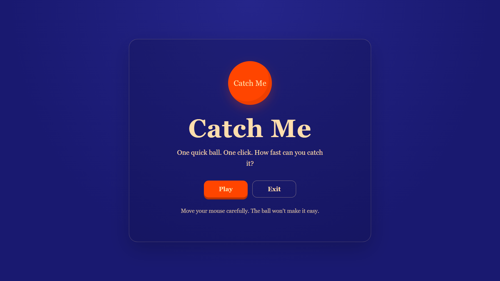
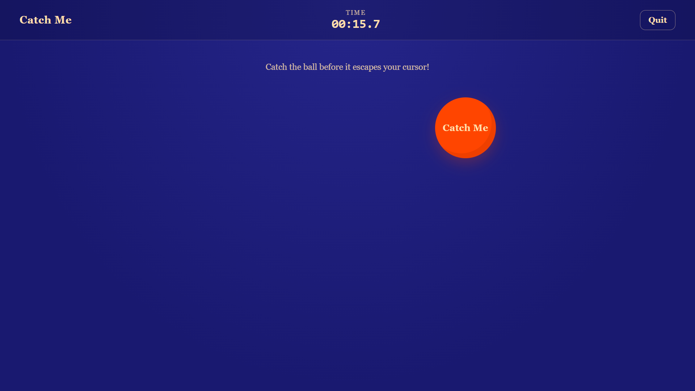
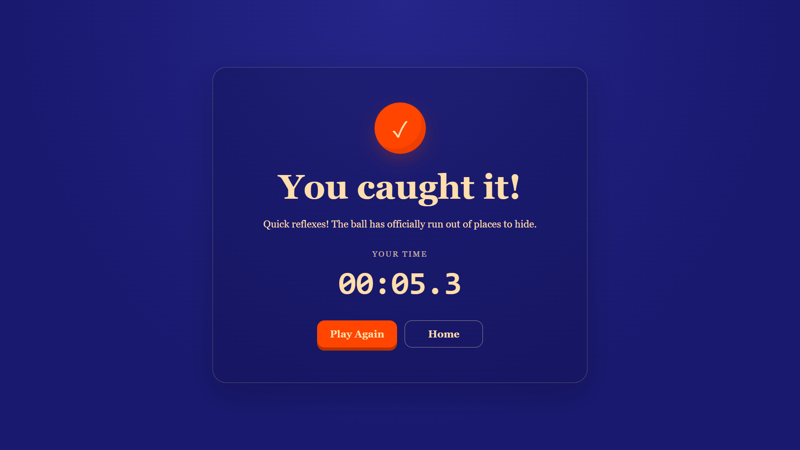

# Catch Me

A simple, browser-based catching game built with HTML, CSS, and JavaScript. The goal is simple: catch the moving ball before it escapes your cursor!

##Features

- **Dynamic Ball Movement:** The ball dodges the cursor as it approaches.
- **Completion Timer:** Tracks how long it takes to catch the ball.
- **Victory Screen:** Displays your final completion time.
- **Replay Option:** Play again or return to the welcome screen.
- **Responsive Design:** Adapts to different screen sizes.
- **Simple UI:** A minimalist design featuring a midnight-blue background and an orange-red ball.

##Technologies Used

- HTML5
- CSS3
- JavaScript

##How to Play

1. Download or clone this repository.
2. Keep all three HTML files in the same folder.
3. Open `OpeningTab.html` in your web browser.
4. Click **Play** to start the game.
5. Move your cursor towards the ball and try to catch it.
6. Check your completion time on the victory screen!

## 📸 Screenshots

### Opening Screen


### Gameplay


### Victory Screen

##Project Structure

```text
Catch-Me/
├── screenshots
├── OpeningTab.html
├── GameTab.html
├── WonTab.html
└── README.md
```

##Author

Prerana Banerjee
